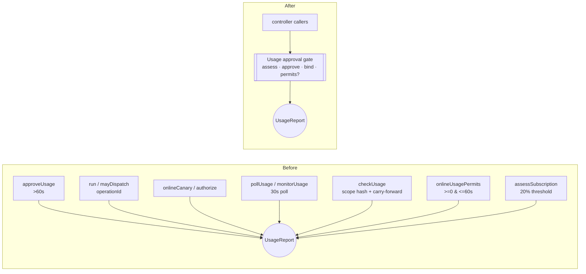
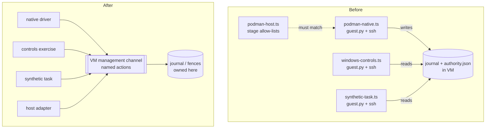
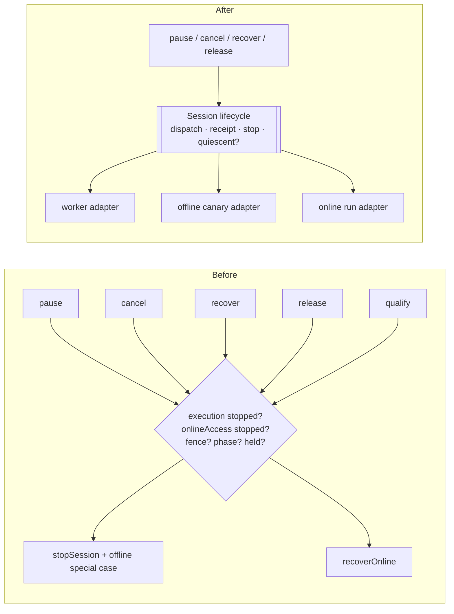
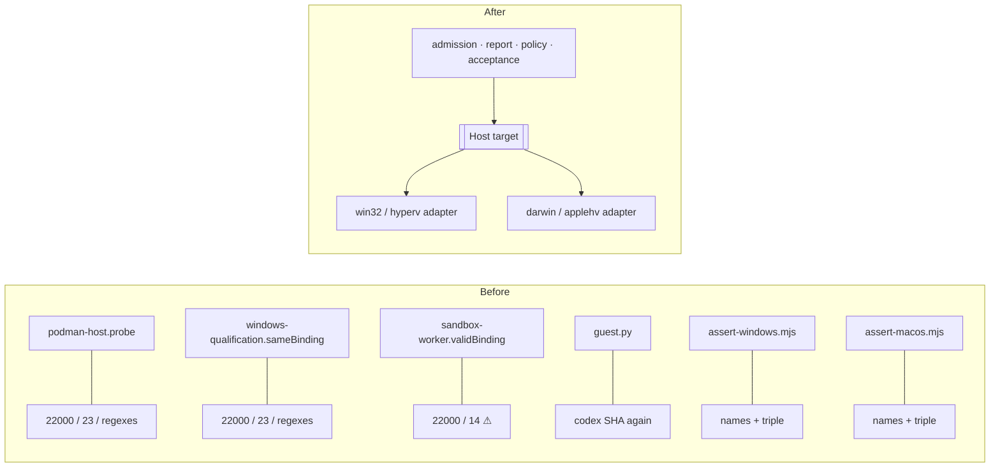

# Developer OS: architecture review

*Run with `/improve-codebase-architecture`, using the `/codebase-design` vocabulary.*
*17 October 2026. Read-only: no repository files were changed.*

## How this was scoped

- **Source.** I read the `developer-os` snapshot in the Developer OS Project: `src/`, `tests/`, `scripts/`, `README.md`, `CONTEXT.md` and `docs/agents/`.
  - **Hot spots.** The snapshot has no git history, so I could not run `git log`. Instead I took hot spots from the README's ticket trail: tickets 4 and 18–25 (Podman worker qualification, online access, authentication, the usage gate, Windows/macOS acceptance). That is where most recent work landed.
- **Glossary.** `CONTEXT.md` is the domain glossary. I use its terms: **Delivery controller**, **Coding worker**, **Paused delivery**, **Cancelled delivery**, **Onboarded repository**.
  - The glossary has no terms yet for several concepts the code relies on heavily: usage approval, qualification, canary, session, fence. Several candidates below name them, so they would be worth adding through `/domain-modeling` if you take one on.
- **ADRs.** There is no `docs/adr/` folder, so no candidate conflicts with a recorded decision.
- **Format.** The skill normally produces an HTML report. As you asked, this is Markdown, with Mermaid before/after diagrams.

**Vocabulary used throughout:**

- **Module**: anything with an interface and an implementation.
- **Interface**: everything a caller must know, including invariants, ordering and error modes.
- **Depth**: behaviour per unit of interface.
- **Seam**: where an interface lives.
- **Adapter**: what fills a seam.
- **Leverage**: what callers gain from depth.
- **Locality**: what maintainers gain from depth.

---

## Summary

| # | Candidate | Strength | Main files |
|---|---|---|---|
| 1 | Usage approval gate | **Strong** | `controller.ts`, `subscription.ts`, `online-access.ts` |
| 2 | VM management channel (one guest program) | **Strong** | `podman-native.ts`, `windows-controls.ts`, `synthetic-task.ts`, `podman-host.ts` |
| 3 | Worker session lifecycle inside the Delivery controller | **Strong** | `controller.ts` |
| 4 | Host target: one module for platform facts, with two adapters | **Strong** | `podman-host.ts`, `podman-platform.ts`, `windows-qualification.ts`, `sandbox-worker.ts`, `windows-controls.ts`, `scripts/assert-*-qualification.mjs` |
| 5 | Qualification report as named check rules | Worth exploring | `windows-qualification.ts`, `subscription-decision.ts` |
| 6 | Host subscription account and credential vault | Worth exploring | `auth-host.ts`, `auth-status.ts`, `subscription-auth.ts`, `subscription-gateway.ts`, `keychain-store.ts`, `windows-auth-store.ts` |
| 7 | Codex app-server client | Worth exploring | `codex-usage.ts`, `codex-mediation.ts` |
| 8 | Fixed inference request contract | Worth exploring | `subscription-gateway.ts`, `codex-endpoint.ts`, `online-native.ts` |
| 9 | Repository ownership ledger | Worth exploring | `controller.ts` |
| 10 | CLI command table | Speculative | `cli.ts` |
| 11 | Deletion-test candidates (hypothetical seams) | Speculative | `sandbox-worker.ts`, `sbx-host.ts`, `model-relay.ts`, `windows-codex-crash.ts` |

The most important pattern across the repo is **safety rules re-stated at every call site instead of owned by one module**. The rules in question are:

- freshness windows
- account identity
- fence checks
- "is anything still running?"
- the guest's authority-directory layout

Each restatement is a little different. In a codebase whose whole purpose is enforcing authority, drift between copies is the main way a bug becomes a security hole.

---

## 1. Usage approval gate

**Strength: Strong**

**Files**
- `src/controller.ts`: `checkUsage`, `approveUsage`, `pollUsage`, `monitorUsage`, `run` (and its `mayDispatch` closure), `onlineCanary` (and its `authorize` closure)
- `src/subscription.ts`: `assessSubscription`
- `src/online-access.ts`: `onlineUsagePermits`

**Problem**

The rule "may this operation spend subscription allowance now?" is a single domain concept, but about seven call sites encode it, with three different freshness forms:

| Where | Freshness check | Rejects a future timestamp? |
|---|---|---|
| `approveUsage` | `Date.now() - Date.parse(usage.checkedAt) > 60000` | No |
| `run` / `onlineCanary` | `usage.approval` must exist, have no `operationId` yet, and be ≤ 60s old | No |
| `onlineUsagePermits` | both `>= 0` and `<= 60000`, on the check *and* the approval | **Yes** |

The approval moves through a lifecycle:

1. fresh check
2. owner approves
3. approval bound to an `operationId`
4. approval consumed, or invalidated by a scope change

That lifecycle is scattered across `checkUsage` (which carries an approval forward when the scope matches), `run` (which binds it), `mayDispatch` and `pollUsage` (which compare `operationId`s), and `onlineUsagePermits`.

`checkUsage` also re-derives `assessSubscription`'s unknown-scope hash (`{account, windows:"unknown"}`) inline.

The deletion test shows the seam is in the wrong place. Deleting `onlineUsagePermits` would just move its body back into the controller. `subscription.ts` is shallow too, because the real rules live in `DeliveryController`.

**Solution**

One in-process module that owns the `UsageReport` from start to finish. It would:

- assess an observation, including the endorsed-account fallback
- carry an approval forward when the scope is unchanged
- accept an owner approval
- bind the approval to exactly one operation
- answer one question, "does this permit operation X now?", the same way for a worker session and an online run

The clock is injected. The controller calls the module inside its existing `change()` transaction and no longer knows about 60-second windows.

**Benefits**

- **Locality:** the freshness rule, the future-timestamp rule and the bind-once rule each live in one place. The missing future-timestamp check in `approveUsage` and `run` gets fixed once, everywhere.
- **Leverage:** `run`, `onlineCanary`, `pollUsage` and `monitorUsage` each shrink to one call.
- **Tests:** a fast, table-driven test at this module's interface, with an injected clock, replaces threshold tests that today need a whole `DeliveryController` fixture (`controls.test.mjs`, `online-access.test.mjs`). The controller keeps one wiring test.
- **Dependency category:** in-process. No adapter is needed.

---

## 2. VM management channel (one guest program)

**Strength: Strong**

**Files**
- `src/podman-native.ts`: the `guest` Python (about 700 lines), `invocation`, `invoke`, `gatewayInvocation`
- `src/windows-controls.ts`: its own `guest` Python and `probe.execute`
- `src/synthetic-task.ts`: its own `guest` Python and `invoke`
- `src/podman-host.ts`: the stage allow-lists in `probe`
- `src/windows-codex-crash.ts`: a Python string spliced in as base64

**Problem**

Three host modules each carry their own Python guest program. Each one re-declares the same authority layout:

- `root = ~/.local/state/aios-offline-v1`
- the `lock` file and `fcntl.flock`
- the `<sandboxId>.json` session journal
- `authority.json` with `fences[sha256(repositoryKey)]`
- its own `private()` permission check

The journal written by `podman-native`'s guest is *read* by the `windows-controls` and `synthetic-task` guests. Those three modules are coupled through a file format that no single module owns.

Each module also builds its own `podman machine ssh … python3 -u -c 'exec(...)'` transport and its own `stage=` vocabulary. `podman-host.ts` keeps allow-lists that must match those stage strings exactly.

The copies have already drifted:
- The `podman` subprocess timeout is `timeout=15` everywhere in `synthetic-task`. In `windows-controls` it is `30 if darwin else 10`.
- On the host side, `synthetic-task` uses a fixed 30000ms while the others scale up for macOS.

I could not tell whether that difference is deliberate. If it isn't, it is a latent macOS timing bug.

**Solution**

One module owns the whole guest program and everything about talking to it:

- the authority-directory layout, the journal and fence schema, and the lock
- the stage vocabulary
- per-platform deadlines
- the ssh transport

It offers named actions: enroll, observe, isolate, execute, stop, collect, boundary-probe, task-execute, task-collect. Callers never see Python, ssh or guest paths. The controls exercise and the synthetic task become callers of named actions, not authors of guest code.

**Benefits**

- **Locality:**
  - The fence and journal rules exist once. Changing the layout is one edit, not three that must agree.
  - Stage strings and the host's allow-lists come from one definition.
- **Leverage:** every new qualification exercise reuses the channel instead of writing more embedded Python.
- **Tests:** today about ten tests in `podman-platform.test.mjs` pull Python functions out of the generated source with `ast.walk`, and other tests overwrite private members (`native.invoke`, `native.gatewayInvocation`). That is testing past the interface. Instead, run whole actions against a fake `podman` executable under a local `python3` and assert on the action results.
- **Dependency category:** local-substitutable (local python3 plus a fake `podman`).

---

## 3. Worker session lifecycle inside the Delivery controller

**Strength: Strong**

**Files**
- `src/controller.ts`, class `DeliveryController`: `run`, `offlineCanary`, `syntheticTask`, `onlineCanary`, `recoverOnline`, `stopSession`, `recordReceipt`, `pause`, `resume`, `cancel`, `recover`, `release`, `qualify`, `approveUsage`, and the `Delivery` interface

**Problem**

`DeliveryController` is the trusted heart of the system, and it is now one class running every workflow. It tracks three kinds of session in parallel:

| Session kind | Adapter it drives | Where it is stored | How it is stopped |
|---|---|---|---|
| Coding worker run | `WorkerAdapter` | `execution` / `sessions` | `stopSession` → `worker.fenceAndStop` |
| Offline canary | `OfflineCanaryRuntime` | Shares `execution`, plus `offlineCanary` | A special branch in `stopSession` and `recordReceipt` |
| Online run | `OnlineAccessRuntime` | `onlineAccess` / `onlineRuns` | A separate `recoverOnline` |

Because no single module answers "is anything still running for this delivery?", the guards `(delivery.execution && delivery.execution.state !== "stopped")` and `(delivery.onlineAccess && delivery.onlineAccess.state !== "stopped")` are repeated across more than a dozen methods. They sit next to the fence, phase and ownership checks: `ownership.fence !== snapshot.ownership.fence || phase !== snapshot.phase || !ownership.held`.

Every new session kind means editing pause, cancel, recover, release, resume, qualify and dispatch. The `Delivery` document has also become a grab-bag of optional evidence fields (`offlineCanary`, `syntheticTask`, `windowsControls`, `onlineAccess`, `onlineRuns`, `onlinePlan`, `onlinePlans`, `usage`, …).

**Solution**

Pull session lifecycle into one deep module behind the controller. It would:

- dispatch with a fresh fence
- record a receipt only if every session identity matches
- treat late responses as `late-response`
- stop with verified revocation and descendant shutdown, or record `uncertain` and the `UNCERTAIN_SESSION` blocker
- answer one question, "are all sessions quiescent?"

The three session kinds become **adapters** at that seam. There are already three real adapters (worker, offline canary, online run) plus the test fakes, so this is a real seam, not a hypothetical one.

The controller's control actions (pause, cancel, recover, release) then become short calls. The controller holds the **Paused delivery** and **Cancelled delivery** semantics, and the session module holds "stopped means really stopped".

**Benefits**

- **Locality:** fencing, receipt matching and uncertainty handling live in one place. Today the offline-canary special cases in `stopSession` and `recordReceipt` are exactly where a missed branch would leave a worker running.
- **Leverage:** a fourth session kind, such as real feature implementation or validation runs, plugs in as one adapter.
- **Tests:** session-safety properties get tested once against an in-memory adapter: late receipts, mismatched identities, timeouts that don't prove a stop. The controller tests stop repeating those properties per workflow.
- **Dependency category:** in-process logic, with the runtimes as injected adapters, using the Ports & Adapters pattern the repo already follows.

> Do this after #1. The usage gate is the most-repeated guard inside these methods, so pulling it out first makes this extraction much smaller.

---

## 4. Host target: one module for platform facts, with two adapters

**Strength: Strong**

**Files**
- `src/podman-host.ts` (`probe`), `src/podman-platform.ts` (`podmanPlatform`, `podmanMachine`), `src/windows-qualification.ts` (`sameBinding`), `src/sandbox-worker.ts` (`validBinding`)
- `src/windows-controls.ts` (`windowsControlNames`, `NativeWindowsControls`), `src/host-canary.ts`, `src/controller.ts` (`qualifyMacosControls`)
- `scripts/assert-windows-qualification.mjs`, `scripts/assert-macos-qualification.mjs`

**Problem**

Facts about Windows/Hyper-V and macOS/AppleHV are copied, slightly differently, into several modules:

- **Minimum OS versions.**
  - Windows build `>= 22000` appears in `probe`, `sameBinding` and `validBinding`.
  - Darwin `>= 23` appears in three places.
  - `validBinding` uses Darwin `>= 14`, which is a *different meaning* of `osVersion` (product version rather than kernel release).
- **Other repeated rules.** Binding regexes (`aios-` prefix, `@sha256:`, semver) and effective-control assertions repeat.
- **The Codex worker SHA** exists as `codexWorkerSha256` in TypeScript and is hard-coded again inside the guest Python.
- **Windows names on shared code.**
  - `qualifyMacosControls` runs through the `windowsControls` runtime and fails with "A trusted Windows controls runtime is required."
  - `WindowsWorkerQualificationReport` is the macOS report's type too.
- **The two acceptance scripts are identical** apart from the target triple (`win32/x64/hyperv` vs `darwin/arm64/applehv`) and the error text. Both repeat the nine check names.

**Solution**

One in-process module holds the per-target facts: provider, architectures, minimum OS and how to read it, image reference, offline template, Codex SHA, deadlines, display names. It also holds the single binding/effective-controls validator that admission, the report and the policy loader all use.

Windows and macOS become two adapters (two values) at that seam. Shared modules get target-neutral names, and one acceptance assertion takes the expected target.

**Benefits**

- **Locality:** a new macOS or Windows release floor is one edit.
- **Leverage:** a third target, such as Linux/KVM, becomes one more adapter rather than a sweep across five files.
- **Tests:** one table-driven test per target replaces the parallel `win32`/`darwin` loops and the cross-platform-mismatch cases spread over three test files.
- **Dependency category:** in-process.

---

## 5. Qualification report as named check rules

**Strength: Worth exploring** (much easier once #4 exists)

**Files**
- `src/windows-qualification.ts`: `workerQualificationReport(delivery, macos)` and the second `adversarialIsolation` pass
- `src/subscription-decision.ts`: `projectSubscriptionDecision`, called from `status()` and `list()`

**Problem**

- **One function computes all nine checks inline.**
  - A later "fallback" pass can *upgrade* a failed `adversarialIsolation` result when other controls passed, and it allows `not-run` probes for names in `windowsControlNames` and a hand-written list.
  - That upgrade logic is the hardest code in the qualification cluster to reason about, and it sits in the middle of a long function.
- **Report time re-reads compiled sources from disk** (`podman-native.js`, `online-native.js`, `npm-artifact.js`) to compare versions.
- **Every plain read re-projects evidence.**
  - `projectSubscriptionDecision` runs on every `status()` and `list()`: it re-reads evidence files, runs the Windows ACL check by spawning PowerShell, hashes `podman-native.js`, and mutates `qualification.ready`.
  - So a read-only `status` call has filesystem and process side effects, and its answer can change without any qualify step having run.

**Solution**

- **The report as a list of named check rules.** Each rule owns its predicate and its blocker text. The target comes from #4.
- **Versions stamped when evidence is produced.** The report compares stored stamps instead of reading files.
- **Projection moves into qualify.** The decision becomes part of an explicit qualify step whose result is written to the ledger. `status` then only verifies pins.

**Benefits**

- **Locality:** the upgrade rule becomes one visible, named rule.
- **Tests:** small evidence records per rule, plus one aggregate test through `controller.qualificationReport`. This replaces long `structuredClone`-then-mutate chains in `windows-qualification-report.test.mjs`.
- **Dependency category:** in-process.

---

## 6. Host subscription account and credential vault

**Strength: Worth exploring**

**Files**
- `src/auth-host.ts`, `src/auth-status.ts`, `src/subscription-auth.ts`, `src/subscription-gateway.ts` (`respond`, `syntheticGatewayApproval`)
- `src/keychain-store.ts`, `src/windows-auth-store.ts`

**Problem**

- **The account identity** `sha256(JSON.stringify([issuer, clientId, subject, hostId]))` is computed in about five places.
- **The required scopes** (`resource.invoke`, `chatgpt.tokens.use.direct`) and the issuer literal repeat across four modules.
- **The registration-record validator** is written twice: `prepareSubscriptionAuth` and `auth-status` `registration()`.
- **"Valid for the inference window" is stated two different ways.** Auth status uses `expiresAt > now + 30000`, and the gateway uses `expiresAt <= approval.expiresAt`. Nothing ties the two together.
- **The vault seam has real adapters but no named interface.**
  - Keychain and DPAPI are genuinely two adapters, but their shapes diverge: only one has `readOnly`, only the other has `createRegistration`.
  - `AuthorizationHostAdapters.keychainStore` is typed as `ReturnType<typeof macKeychainStore>`, so the Windows store passes as a "mac" store.
  - `windowsAuthStore(dir, paths)` is called in three places purely for its side effect (an ACL check), not as a store.

**Solution**

1. **An account module.** It owns identity, encoding, eligibility at a given time, and "load by id from this host's vault".
2. **A named credential-vault interface** filled by the Keychain and Windows adapters.
3. **A separate owner-private-storage module.** POSIX mode bits and the macOS ACL check go in one adapter, the PowerShell ACL check in the other. Callers no longer have to remember to call both checks, and an ACL check stops being disguised as a store constructor.

The OAuth broker (`SubscriptionAuthBroker`) is already deep and should stay as it is.

**Benefits**

- **Tests:** identity and eligibility become one pure table test. Auth-status tests stop mocking `fs` and `child_process` through `syncBuiltinESMExports` and use a fake vault adapter instead.
- **Dependency category:** in-process logic, plus a local-substitutable vault.

---

## 7. Codex app-server client

**Strength: Worth exploring**

**Files**
- `src/codex-usage.ts`: `codexSubscriptionReader`
- `src/codex-mediation.ts`: `inspectCodexMediation`

**Problem**

Both modules separately implement the same steps: spawn `app-server`, split newline-delimited JSON-RPC messages, run initialize → initialized → `account/read`, apply a 4000ms timeout, and cap output size. The copies differ in ways nothing documents:

| | `codex-usage` | `codex-mediation` |
|---|---|---|
| Byte cap | 256 KiB | 64 KiB |
| Environment | Inherits the full host environment, including the owner's `CODEX_HOME` | Builds an isolated empty home |
| Executable digest | Not verified | Pinned |

Inheriting the environment is probably deliberate for the usage reader, which needs the owner's account. Skipping the executable digest is harder to justify. Either way, the code doesn't say.

**Solution**

One module for "run a pinned Codex app-server session and run a short request script", with the environment policy and the expected digest as explicit inputs. The usage reader and the mediation probe become two short callers that state their choices.

**Benefits**

- **Locality:** handshake, caps and timeouts live in one place, and the env/digest choice is visible at each call site.
- **Tests:** one fake app-server covers both callers.
- **Dependency category:** local-substitutable (a fake script stands in for the binary).

---

## 8. Fixed inference request contract

**Strength: Worth exploring**

**Files**
- `src/subscription-gateway.ts`: `gatewayMarker`, `gatewayRequest`, `syntheticGatewayResponse`
- `src/codex-endpoint.ts`: `codexEndpointFixture` (Python)
- `src/online-native.ts`: the relay's synthetic body

**Problem**

The rules for an acceptable request are written in two languages:

- **TypeScript side:** the request, the marker and the 8-event response.
- **Python fixture side:** the marker and model name are hard-coded again, the request checks are re-implemented (user content, the `mcp__` tool ban, `stream`/`store`), and the response is rebuilt.

If the two drift apart, only the `requestSha256` pins would catch it. `codex-endpoint.test.mjs` parses the Python AST to evaluate the guards, which is testing past the interface.

**Solution**

One module owns the fixed request, the marker and the canonical response. It generates the values the Python fixture needs and passes them in through the fixture's config line, instead of having them typed into the script.

**Benefits**

- **Locality:** changing the request is a single edit.
- **Tests:** they check the fixture against the shared contract.
- **Dependency category:** in-process.

---

## 9. Repository ownership ledger

**Strength: Worth exploring**

**Files**
- `src/controller.ts`: `withDatabase` (schema migration v0→v2), `change`, `advanceFence`, `release` (queue hand-off), `resume` (queued re-admission), `repositoryKey`

**Problem**

The SQLite schema, migrations, the per-repository owner table and the "one owner delivery per canonical repository, then hand off to the oldest queued request" rule all live as private methods of `DeliveryController`. They sit alongside workflow code.

The ownership rule is one of the system's core invariants. Today it can only be exercised through the whole controller. Queue hand-off logic also exists twice:

- `release` scans for the next queued delivery.
- `resume` re-admits a queued delivery when the owner slot is empty.

**Solution**

A ledger module that owns persistence and the ownership/fence invariants:

- admit or queue
- advance the fence (compare-and-swap)
- release with hand-off
- transactional document update

The controller asks the ledger for those operations and never writes SQL.

**Benefits**

- **Locality:** schema changes and migrations live in one place.
- **Tests:** ownership and queue properties get tested directly against real SQLite in a temporary directory. That is already the repo's test style, so no new adapter is needed.
- **Dependency category:** local-substitutable.

---

## 10. CLI command table

**Strength: Speculative**

**Files**
- `src/cli.ts`: about ten hand-written cross-option rules, command names mapped through a ternary chain, runtime wiring

**Problem**

- **Which options each command accepts is encoded procedurally**, for example which commands take `--podman-machine`, `--adversarial` or `--dependency-policy`. The `cli-guardrails` tests have to spawn `dist/cli.js` to check it.
- **Some auth commands bypass the controller entirely:** `prepare-auth`, `authorize-auth`, `auth-status`.
- **`NativeWindowsControls` is wired up for `qualify-macos-controls` too.** This is the same naming leak as #4.
- **The exact-plan inference path is unreachable from the CLI.** The CLI doesn't expose `prepareOnline` or `approveOnline`, and `NativeOnlineAccess` provides no `requiresExactApproval` or `inferenceRequest`. That may be intentional at this stage.

**Solution**

A declarative command table. Each entry lists the command's options, the runtimes it needs, and the controller action it calls. Tests check the table directly, and keep a few spawn tests for the exit-code and JSON-error contract.

This is speculative because the CLI may change a lot once production delivery is enabled.

---

## 11. Deletion-test candidates

**Strength: Speculative.** These depend on your roadmap.

| Item | Deletion test | Note |
|---|---|---|
| `sandbox-worker.ts` `SandboxRuntime` + `sbx-host.ts` + `workspace.ts` `materializeWorkspace` (the Docker Sandboxes line) | **Concentrates.** No production adapter exists, and `SbxHostAdapter.qualified()` always returns false. | The README calls this path "retained for historical investigation". If it's off the roadmap, deleting it removes complexity rather than moving it. Keep `admittedPath`, because `offline-canary` uses it. |
| `model-relay.ts` `RevocableModelGrant` | One adapter, so a hypothetical seam. | Its only user is `syntheticRelayCanary`. |
| `windows-codex-crash.ts` | Just a string constant. | Belongs inside the guest program from #2. |
| Canaries inside production modules | Not a deletion, a move. | About 300 of `subscription-gateway.ts`'s ~800 lines are `hostGatewayCanary`. Moving the canaries next to the qualification exercise would make the gateway's real interface visible. |

## Cross-cutting smells (small, mechanical)

These aren't deepening candidates on their own, but each would fold into the candidate that touches it.

- **Path containment is implemented seven times.**
  - The copies: `contains` (controller), `inside` (subscription-auth, auth-status, codex-mediation), `within` (subscription-decision), `outside` (onboarding), and an inline copy in npm-artifact.
  - This is a security check, so it should be one function.
- **Each "version" is the SHA of its module's own source.**
  - `onlinePolicyVersion` hashes `controller.js` and `subscription.js`, so *any* controller edit invalidates every prepared online plan.
  - `windowsControlsVersion` also hashes `controller.js`.
  - This couples unrelated modules through their compiled bytes.
- **One number, many meanings.** `30000` serves as the approval TTL, the grant deadline, the auth eligibility window, `deadlineSeconds: 30`, two polling intervals, and the default `observe` timeout. Name each concept.
- **Circular import.** `controller.ts` imports `windowsControlsVersion` and `windowsControlNames` from `windows-controls.ts`, and `windows-controls.ts` imports `DeliveryController` and constructs one inside `NativeWindowsControls.qualify`. The runtime that the controller depends on builds its own controller. #3 together with #2 removes the need.
- **Stale navigation map.** `graft/src/controller.md` doesn't list `qualifyControls` or `qualifyMacosControls`, both of which exist in the current source, so its line ranges are likely off as well. Agents relying on graft cards will be misdirected. That is a `/retro` finding: regenerate graft in CI or as a pre-commit check.

---

## Top recommendation

**Start with #1, the usage approval gate.**

- **Smallest and safest.** It is pure in-process logic with an injected clock, so you can build it test-first (`/tdd`) without touching the VM, the vault or the network.
- **Fixes a real inconsistency.** Today only `onlineUsagePermits` rejects future-dated observations and approvals. `approveUsage` and `run` don't. That is a spending boundary, which is exactly where consistent rules matter.
- **It's in the hot path.** Tickets 20–25 (online access, authentication, the usage gate) are where work is landing now. Deepening pays off fastest where change is happening.
- **It shrinks #3.** The usage checks are the most-repeated guard inside the controller methods. Pulling them out first makes the session-lifecycle extraction much smaller and less risky.

**Then #2, the VM management channel.** The three guest programs have already drifted on timeouts, and the controls exercise and synthetic task depend on a journal format nobody owns. It is the highest-risk duplication in the qualification work.

## Next step

The skill's next stage is a grilling loop on whichever candidate you pick: constraints, what sits behind the seam, and which tests survive. During that loop, new terms go into `CONTEXT.md` (for example *usage approval*, *session*, *fence*). If you reject a candidate for a lasting reason, that reason can be recorded as an ADR so future reviews don't suggest it again.

**Which of these would you like to explore?**
