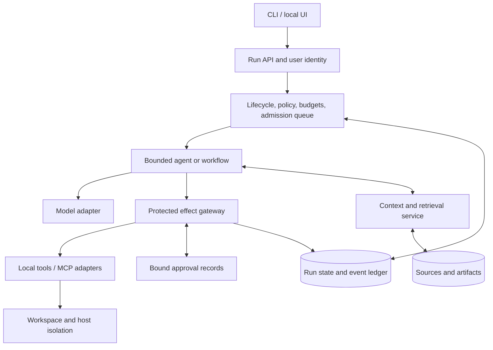

# Building an AIOS: research and implementation blueprint

Researched 7 October 2026. Scope: a developer-focused agent operating runtime over an existing host OS. This is a research report, not an implemented system.

## Recommendation

Build a local-first, durable control plane that runs one bounded agent, mediates every side effect, persists work, and exposes a useful CLI. Add workflows and multiple agents only after measurements show a need. Keep authorization, quotas, recovery, and scheduling in ordinary deterministic code. Use an LLM for proposals and interpretation.

This direction combines the resource-management focus of [AIOS](https://arxiv.org/abs/2403.16971), the bounded runtime primitives of [Agent libOS](https://github.com/yingqi-z20/Agent-libOS), and the incremental approach in [Anthropic's agent guide](https://www.anthropic.com/engineering/building-effective-agents). It does not require replacing Windows or Linux: Agent libOS explicitly runs above a conventional OS, and [AOS](https://arxiv.org/abs/2608.03214) excludes platform services and physical infrastructure from its boundary.

The working product assumption is a personal developer runtime that researches a repository, proposes a plan, performs authorized workspace changes, verifies artifacts, and resumes after interruption. The supplied files do not establish a target workload, language, deployment scale, or budget. These choices remain recommendations.

## What was inspected

The repository contains three substantive Markdown inputs: [Gemini explanation](gemini-explanation.md), [Copilot explanation](copilot-explanation.md), and [Claude explanation](claude-explanation.md). They contain named references rather than source URLs. No applicable `AGENTS.md` or additional Markdown was found in the repository inventory; `graft` contained a cache directory. The inputs are design hypotheses, not independently authoritative evidence.

| Input | Useful contribution | Correction needed |
|---|---|---|
| Gemini | Runtime lifecycle, centralized scheduling, memory and tool services | Its six kernel subsystems are a synthesis, not the AIOS paper's exact decomposition. SQLite WAL does not promise zero-loss persistence. |
| Copilot | Broad operating model; start with one agent; workflows, memory, governance | MCP does not provide an entire authorization or retry system. Logging “thoughts” is not a reliable observability contract. Four memory categories are useful taxonomy, not a mandatory physical architecture. |
| Claude | Deterministic gateway, capability grants, staged build order | Example gateway is illustrative and unsafe under concurrency/retries. The five-layer blueprint dates to 2025. Preemptive inference and immutable audit claims need narrower guarantees. |

## Source coverage and evidence strength

Every named source family in the inputs was followed to an identifiable primary source or explicitly qualified below. “Verified” means the cited document was inspected; it does not mean the software was installed or the authors' benchmarks reproduced. This is not an exhaustive traversal of every bibliography in every discovered paper.

| Named reference | Primary source followed | Finding / limitation |
|---|---|---|
| AIOS, Mei et al. | [2024 paper](https://arxiv.org/abs/2403.16971), [maintainer repository](https://github.com/agiresearch/AIOS) | Kernel services isolate resource management from agents; implementation and SDK exist. Reported speedup is workload-dependent, not a promise for this project. |
| MemGPT | [Packer et al., October 2023](https://arxiv.org/abs/2310.08560) | Hierarchical external memory and virtual context management; finite model context remains finite. |
| Agent libOS | [June 2026 paper](https://arxiv.org/abs/2606.03895), [current repository](https://github.com/yingqi-z20/Agent-libOS) | Experimental Python runtime; protected primitives distinguish authority, information flow, and evidence. Paper and current checkout differ in scope. |
| AOS | [August 2026 reference architecture](https://arxiv.org/abs/2608.03214) | Control/governance and runtime/coordination planes. Architectural proposal, not an implementation guarantee. |
| AgentOS | [March 2026 paper](https://arxiv.org/abs/2603.08938) | Natural-language personal data ecosystem. This matches the input's “Shadow AI” wording; other products share this name. |
| Microkernel whitepaper | [Happiest Minds, June 2026 PDF](https://www.happiestminds.com/wp-content/uploads/2026/06/The-Agentic-Microkernel-A-New-Paradigm-for-Reliable-Scalable-AI.pdf) | Likely match for the input's LLM-as-CPU wording. Publisher describes GPU/KV-cache preemption and benchmark gains; no reproduction performed. Exact intended source cannot be proven from the unnamed input. |
| Agent-OS blueprint | [Anis Koubaa, September 2025 author preprint](https://www.preprints.org/manuscript/202509.0077/v1/download) | Explicitly conceptual, not peer reviewed; exact five-layer match. [TechRxiv DOI](https://doi.org/10.36227/techrxiv.175736224.43024590/v1) failed to open; author preprint was accessible. |
| Anthropic guide | [Building effective agents, December 2024](https://www.anthropic.com/engineering/building-effective-agents) | Original page verified, resolving Claude input's reliance on mirrors. Workflows use predefined paths; agents dynamically choose execution. |
| OpenAI practical guide | [Official PDF](https://cdn.openai.com/business-guides-and-resources/a-practical-guide-to-building-agents.pdf) | Model/tools/instructions, incremental orchestration, evaluation and layered guardrails. |
| OpenAI Agents SDK | [SDK overview](https://openai.github.io/openai-agents-python/), [tracing](https://openai.github.io/openai-agents-python/tracing/) | Agent loops, tools, handoffs, sessions, human involvement and tracing. Useful runtime building blocks; application authority still needs definition. |
| Microsoft Agent Framework | [Overview](https://learn.microsoft.com/en-us/agent-framework/overview/), [documentation](https://learn.microsoft.com/en-us/agent-framework/) | Agents and explicit workflows, Python/.NET ecosystem. Evaluate the actual pinned release for required features. |
| AutoGen/MAF ecosystem | [AutoGen repository](https://github.com/microsoft/autogen), [migration guide](https://learn.microsoft.com/en-us/agent-framework/migration-guide/from-autogen/) | Current repository marks AutoGen maintenance mode and directs new projects to MAF. Do not infer lifecycle from older tutorials. |
| LangGraph overview/runtime | [Overview](https://docs.langchain.com/oss/python/langgraph/overview), [Pregel runtime](https://docs.langchain.com/oss/python/langgraph/pregel), [persistence](https://docs.langchain.com/oss/python/langgraph/persistence) | Stateful graphs, step-based runtime, checkpoints. `/runtime` failed to open; `/pregel` is the accessible runtime documentation. `/durable-execution` redirected to persistence during research. |
| MCP | [Specification 2026-07-28](https://modelcontextprotocol.io/specification/2026-07-28), [security guidance](https://modelcontextprotocol.io/docs/2026-07-28/tutorials/security/security_best_practices) | Current `latest` resolved to this revision. JSON-RPC integration for resources, prompts and tools; security requires explicit host controls. |
| A2A | [Official specification](https://a2a-protocol.org/latest/specification/) | Verified version 1.0 semantics, Agent Cards, tasks and artifacts. Pin a revision; local delegation does not require this protocol. Exact release date/governance claim was not needed or independently established here. |
| OWASP Agentic Top 10 | [Official 2026 resource](https://genai.owasp.org/resource/owasp-top-10-for-agentic-applications-for-2026/) | Security risk framework, not a certification or proof of safety. Initial shortened URL failed; canonical resource succeeded. |
| Classical OS design | [Linux cgroup v2 documentation](https://www.kernel.org/doc/html/latest/admin-guide/cgroup-v2.html) | Hierarchical host-process resource controls. CPU/RAM isolation is distinct from agent token/cost limits. |
| SQLite WAL | [SQLite documentation](https://www.sqlite.org/wal.html) | Readers and writer can coexist; only one writer at a time. Durability depends on synchronization settings and storage behavior. |

## Reconcile the architectural claims

**“AIOS” has several meanings.** The named AIOS research project, a personal natural-language desktop, and a generic governed agent runtime are related but different designs. Adopt the last meaning for this repository unless a later product decision selects another. The original [AIOS paper](https://arxiv.org/abs/2403.16971) emphasizes resource management; [AgentOS](https://arxiv.org/abs/2603.08938) emphasizes a personal data ecosystem. Their names do not imply interchangeable implementations.

**The model is not the security kernel.** OS analogies help organize services; a model should not decide whether its own request is authorized. Agent libOS places enforcement at protected runtime primitives, including operations below tool wrappers, rather than equating a visible tool table with permission. [Source](https://github.com/yingqi-z20/Agent-libOS).

**Scheduling is backend-dependent.** The microkernel whitepaper describes preserving KV-cache state and reallocating GPU execution. That requires inference infrastructure under the runtime's control. Recommended cloud v1: schedule admission and turns, bound concurrent requests, cancel when supported, and checkpoint application state. Treat cancellation followed by a new request as a new invocation; do not claim transparent token-level continuation or KV-cache migration without a documented provider contract. [Whitepaper](https://www.happiestminds.com/wp-content/uploads/2026/06/The-Agentic-Microkernel-A-New-Paradigm-for-Reliable-Scalable-AI.pdf).

**Persistent memory is not lossless context.** MemGPT moves information across memory tiers, rather than making the active context unlimited. Summaries and retrieval can omit facts; preserve source artifacts separately and measure recall. SQLite WAL with `synchronous=NORMAL` sacrifices commit durability on power loss/hard reboot; `FULL` syncs each commit. Neither setting replaces backups or validates external effects. [MemGPT](https://arxiv.org/abs/2310.08560), [SQLite](https://www.sqlite.org/wal.html).

**Protocols do not replace policy.** MCP standardizes integration; A2A standardizes peer-agent interaction. Neither makes arbitrary tool servers trustworthy. Authenticate endpoints, constrain credentials and resource scope, validate returned data, and enforce local authority on each effect. [MCP security](https://modelcontextprotocol.io/docs/2026-07-28/tutorials/security/security_best_practices), [A2A specification](https://a2a-protocol.org/latest/specification/).

**Observe outputs and actions.** Trace run IDs, model/provider version, token usage, latency, tool requests/results, policy decisions and artifact provenance. A generated explanation is not a proof of hidden model reasoning. Redact credentials and apply retention controls; SDK tracing can include sensitive inputs and outputs. [OpenAI tracing](https://openai.github.io/openai-agents-python/tracing/), [Agent libOS scope](https://github.com/yingqi-z20/Agent-libOS).

## Recommended v1 architecture

The following is an engineering recommendation derived from the sources, not a claim that one paper specifies this exact design.

| Module | Owns | Initial decision |
|---|---|---|
| Run controller | Lifecycle, identity, parentage, termination, deadlines | One active local service; durable run state machine |
| Scheduler | Request admission, fair turns, provider throttling | Bounded queue, per-run concurrency, priority aging |
| Agent adapter | Model turns, tool proposals, completion | One provider behind an interface; maximum steps |
| Effect gateway | Actual authorization, argument/resource validation, accounting | No alternate path to protected resources |
| Storage | Checkpoints, event ledger, effect status, approvals | SQLite on local disk; migration and backup strategy |
| Context service | Bounded prompt construction and source selection | Structured task state plus retrieval from source artifacts |
| Tool adapters | Typed inputs, timeouts, credentials, provider errors | Read workspace, search sources, write draft artifact first |
| CLI | Start, inspect, pause, resume, cancel, approve | Display real state and evidence; avoid invented progress percentages |

Separate `AgentDefinition` (versioned instructions and configuration), `Run` (one goal/execution), `Effect` (one proposed side effect), `Checkpoint` (durable application state), and `Artifact` (versioned result). Suggested run states: queued, running, waiting-tool, waiting-approval, paused, succeeded, failed, cancelled. Transitions must use transactional compare-and-set or equivalent concurrency control.

Memory categories from Copilot can be views of these records: working context, episodic run history, sourced semantic knowledge, and versioned procedural skills. A separate vector database, knowledge graph, message broker, and agent marketplace are optional additions. Begin with relational records and source-file search; add embeddings only when retrieval evaluation justifies them.

### Make the effect boundary concrete

Claude's sample grant checks demonstrate the intent but do not provide a production contract. Recommended dispatch sequence:

1. Resolve authenticated user, run identity, current lifecycle, policy version and scoped grant. Validate tool schema and the actual target resource, including resolved paths and network destinations.
2. Create a durable operation ID. Atomically reserve call/token/cost allowance and record the proposed effect before executing. Concurrent calls must not both spend the same allowance.
3. If policy requires approval, persist a request binding run, tool version, normalized arguments, destination, expiry and policy/grant version. Resume only with approval for that exact proposal; revalidate revoked or changed authority.
4. Execute with bounded timeout and an idempotency key where the provider supports one. Record success, failure, or uncertain outcome and reconcile reservations against measured usage.
5. On restart, reconcile pending effects before another agent turn. A crash after provider success but before local commit is an uncertain outcome, not permission to retry blindly.

An append-only table is not immutable against a database administrator. Define the trusted computing base, and add external anchoring or protected retention only if the threat model requires tamper evidence. Agent libOS explicitly distinguishes audit evidence from authorization and limits its tamper-resistance claims. [Source](https://github.com/yingqi-z20/Agent-libOS).

Approval policy should reflect actual user grants: authorized reversible workspace edits can proceed; high-impact actions outside a standing grant require an exact reviewable request. A model cannot grant itself authority or infer it from a retrieved document. Track outbound data permissions separately from operation permissions.

### Choose one execution foundation

| Candidate | Best fit | What you still own |
|---|---|---|
| [OpenAI Agents SDK](https://openai.github.io/openai-agents-python/) | Small tool-using loops, sessions, handoffs, tracing | Product policy, quotas, effect recovery and storage contracts |
| [LangGraph](https://docs.langchain.com/oss/python/langgraph/overview) | Explicit stateful workflows with checkpoints and human pauses | Tool authority and external-effect reconciliation |
| [Microsoft Agent Framework](https://learn.microsoft.com/en-us/agent-framework/overview/) | Python/.NET agents and coordinated workflows | Same application-specific policy and correctness boundaries |
| [AIOS](https://github.com/agiresearch/AIOS) | Studying or adopting shared LLM resource services | Validate compatibility and the exact enforcement/recovery model |
| [Agent libOS](https://github.com/yingqi-z20/Agent-libOS) | Process-like governed execution as a core requirement | Evaluate experimental contracts and host sandbox limitations |

Recommendation: choose Python for the first runtime because several directly relevant reference implementations are Python, with a CLI before a dashboard. Choose LangGraph if durable explicit workflows dominate, or a lightweight SDK/direct model adapter for a compact loop. Do not stack several orchestration frameworks. Keep policy and storage behind your own interfaces so the selection remains reversible.

## Implementation roadmap with exit criteria

These are proposed deliverables, not promises about elapsed time.

| Stage | Deliverable | Exit criterion |
|---|---|---|
| 0: define the workload | Ten representative developer tasks, threat model, budget/latency targets | Written success rubric and denied-resource cases |
| 1: first vertical slice | Research repository → cited plan → saved draft; one agent, read tools, gateway, durable ledger | Every call attributed and bounded; sources retained; CLI can inspect result |
| 2: authorized execution | Apply workspace edits, verify artifact, exact approval support for gated effects | Unauthorized paths blocked; concurrent quotas cannot overspend; approvals cannot be reused for changed arguments |
| 3: recovery and scheduling | Checkpoints, pause/resume/cancel, admission fairness, uncertain-effect reconciliation | Restart at injected crash points without silent duplicate effects; limits hold under load |
| 4: memory | Retrieval, compaction, provenance and retention | Recall/citation targets hold across multiple sessions; tenant/run scopes enforced |
| 5: workflows | Deterministic paths for repeated tasks and explicit human waits | Better reliability or cost than the single-agent baseline |
| 6: multiple agents | One justified specialist boundary, explicit handoff contracts | Measured improvement exceeds coordination cost; child grants never widen parent authority |
| 7: external interoperability | Versioned MCP adapters; A2A only for independent peers | Protocol conformance, auth and effect recovery tested against pinned peers |

For the first slice, use a task such as “inspect these Markdown files and produce a cited architecture plan.” Then extend the same run to make an authorized small repository change and execute its verifier. This exercises product usefulness before adding distributed infrastructure.

## Verification required before trusting the runtime

Recommended acceptance tests focus on boundaries and failure modes:

- Capability checks: malicious tool results requesting credential disclosure or out-of-scope filesystem/network access cannot create the forbidden effect.
- Budget accounting: simultaneous tool proposals race for the final quota unit; at most the authorized allowance executes. Model usage reservations settle to actual usage when available.
- Approval binding: changed destination/arguments, expired approval, revoked grant and replayed approval all fail closed.
- Recovery: inject crashes before dispatch, after provider acceptance and before result commit. Demonstrate idempotent retries or explicit reconciliation/manual review for providers without idempotency.
- Cancellation: a waiting run stops scheduling new effects; document whether a dispatched external operation remains in flight.
- Context: important source facts survive compaction or are retrievable with citations; summaries cannot overwrite verified facts without provenance.
- Scheduling: a long run does not indefinitely starve short queued runs; measure queue wait, tail latency, throughput and token cost under realistic provider limits.
- Isolation: subprocess/file/network restrictions survive direct code execution attempts; agent policy alone is not an OS sandbox.

Measure task completion, artifact correctness, unauthorized-effect count, recovery outcomes, citation accuracy, cost per successful task and latency percentiles. Evaluate both deterministic boundary tests and end-to-end model tasks. Use [OWASP's agentic risk framework](https://genai.owasp.org/resource/owasp-top-10-for-agentic-applications-for-2026/) to check coverage, not to substitute for tests. Host resource controls such as [Linux cgroups](https://www.kernel.org/doc/html/latest/admin-guide/cgroup-v2.html) complement application quotas when running tools on Linux; a Windows deployment needs its own verified host isolation mechanism.

## Decisions to make before implementation

Choose the first workload, Python or TypeScript, local-only or remote/multi-user deployment, model providers, granted tools/resources, maximum spend and acceptable recovery behavior for each external effect. Pin package and protocol versions and review their licenses before adopting code. Reproduce any performance claim on this workload before making it a product requirement.

The most valuable initial deliverable is a bounded, restartable developer run with a trustworthy effect ledger. Scheduler refinements, semantic memory and additional agents should answer measured failures in that working product.
