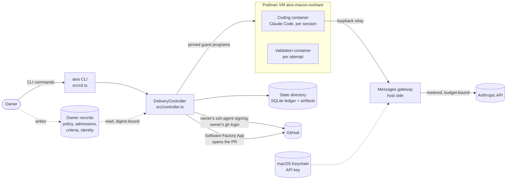

# Architecture

How Developer OS is put together: what runs where, which boundaries it trusts,
and how one delivery moves from a request to a completed merge. For what is
implemented and qualified today, read [implementation status](implementation-status.md).
For the words used here, read [CONTEXT.md](../CONTEXT.md). The decisions behind
the shape are in [`docs/adr/`](adr/).

## Goals and constraints

- **Deliver a feature without the owner in the loop**, from a written request
  through validation, a signed pull request, checks, review, merge, main
  synchronization and branch cleanup.
- **Never give the worker authority.** The coding agent runs without
  credentials, network or management access. Its output is data to admit, never
  an instruction. Repository text can't choose a privileged effect either.
- **Every effect is durable and reconcilable.** The controller records intent
  before each external effect, binds it to exact revisions and pins, and can
  observe after a crash whether the effect landed.
- **One host.** The controller and its VM run only on the owner's Mac
  ([ADR 0007](adr/0007-macos-only-owner-host.md)). The CLI refuses any other
  operating system.
- **Production stays disabled** until a separate decision enables it. Every
  stage can run natively under the owner's records, but `DELIVERY_NOT_ENABLED`
  and `productionEnabled: false` remain.

## System context

- The **owner** runs the CLI and writes every trust input by hand, outside all
  repositories: the owner policy, the coding and validation admission records,
  the feature criteria file, the onboarding attestation, the publication
  identity and the production admission record. The controller reads them by
  path and binds their SHA-256 into its records. Nothing is discovered from a
  repository or from worker output.
- The **controller** is the only component with authority. It composes the
  ledger, the VM transports, the gateway and the GitHub adapters.
- The **VM** is one dedicated Podman machine. Each coding session and each
  validation attempt gets its own hardened container: no network, no
  capabilities, a read-only root, a pinned seccomp profile, and only its own
  session's folders mounted ([ADR 0009](adr/0009-per-session-containers-in-one-dedicated-vm.md)).
  The guest programs that manage containers are pinned by digest, and the
  owner's admission records admit exactly those digests
  ([owner hosts](owner-hosts.md#admitted-guest-programs)).
- **Model access** is metered. The owner's Anthropic key stays in the Keychain.
  A coding session reaches the pinned Claude model only through a relay on its
  own loopback and the host's Messages gateway, holding a revocable per-session
  capability ([ADR 0002](adr/0002-mediated-general-coding-session.md),
  [ADR 0006](adr/0006-claude-through-metered-api-key.md),
  [ADR 0008](adr/0008-claude-code-replaces-codex.md)).
- **GitHub** effects use the owner's own identities: the owner's key signs the
  commit through ssh-agent, the owner's `gh` login pushes, observes and merges,
  and the Software Factory App authors the pull request.

## A delivery, stage by stage

Each stage is a `DeliveryController` method with a CLI command of the same
name. Each one re-checks what the previous stage proved before acting.

| Stage       | CLI                                     | What it proves or does                                                                                                            | Contract                                            |
| ----------- | --------------------------------------- | --------------------------------------------------------------------------------------------------------------------------------- | --------------------------------------------------- |
| Intake      | `start`                                 | Durable request, onboarding snapshot, ownership of the canonical repository, spend budget and allowances                          | [README](../README.md#submit-and-inspect-a-request) |
| Plan        | `plan-feature`, `clarify-feature`       | Owner-written criteria and verification for this exact request ([ADR 0004](adr/0004-cli-delivery-integration.md))                 | [Feature candidates](feature-candidate.md)          |
| Baseline    | `validate-baseline`                     | Unchanged main passes the owner's validation contract                                                                             | [Isolated validation](isolated-validation.md)       |
| Code        | `code-feature`                          | One Claude Code turn in a fresh container; stopped output admitted file by file as a candidate                                    | [Feature candidates](feature-candidate.md)          |
| Validate    | `validate-candidate`                    | The exact candidate passes, with revision-bound evidence                                                                          | [Isolated validation](isolated-validation.md)       |
| Repair      | `repair-feature`                        | Bounded fix cycles, each revalidated (three cycles or 60 active minutes by default)                                               | [Bounded repair](bounded-repair.md)                 |
| Publish     | `publish-feature`                       | Owner-signed commit of the validated tree, App-authored PR                                                                        | [Signed publication](signed-publication.md)         |
| PR checks   | `monitor-pr-checks`, `repair-pr-checks` | Trusted workflow runs pass for the PR's exact head                                                                                | [Trusted checks](trusted-pr-checks.md)              |
| Review      | `monitor-review`, `repair-review`       | Findings resolved; owner approval only for a gated change ([ADR 0005](adr/0005-change-gate-replaces-universal-merge-approval.md)) | [Review and change gate](review-owner-approval.md)  |
| Merge       | `merge-feature`                         | Default branch fast-forwarded to the exact approved head, with a lease on main                                                    | [Conditional merge](conditional-merge.md)           |
| Main checks | `monitor-main-checks`                   | The merge is in main and main's own checks pass at its tip                                                                        | [Main verification](main-verification.md)           |
| Main sync   | `sync-main`                             | The delivery checkout's main fast-forwarded to exactly the verified revision                                                      | [Main synchronization](main-synchronization.md)     |
| Cleanup     | `cleanup-branches`                      | Branches merged into verified main deleted; protected, unmerged and newer ones kept; delivery complete                            | [Branch cleanup](branch-cleanup.md)                 |

Controls apply at any stage: `pause`, `resume`, `cancel`, `recover` and
`release`. They fence the running session or attempt, and a session whose stop
can't be proven keeps the repository owned until recovery. Each `reconcile-*`
command only observes, so it is safe to run after a crash.

## Module map

`src/` is flat. The modules group by responsibility as follows.

**Entry and composition**

- `cli.ts`, `cli-commands.ts`: parse options, declare each command's required
  inputs and runtimes, install native adapters from the owner's records, and
  emit JSON. `cli.ts` holds the long help text that lists every option.
- `controller.ts`: `DeliveryController`, the public interface that sequences
  every stage, enforces phases and fences, and composes everything below.
- `errors.ts`: public errors carry only fixed, non-input-derived messages.

**Durable state and host safety**

- `repository-ledger.ts`: SQLite (WAL, full sync) migrations, transactional
  documents, fence compare-and-swap and FIFO ownership per repository.
- `session-lifecycle.ts`: stop evidence and retained-session quiescence.
- `private-storage.ts`, `path-containment.ts`, `redaction.ts`, `host-git.ts`:
  owner-only storage checks, path containment, credential detection and the
  neutral working directory for host Git.

**Intake and planning**

- `onboarding.ts`: verified, unknown, conflicting and owner-attested facts
  about a repository, and its change-gate rules.
- `feature-candidate.ts`, `feature-criteria.ts`: the planner interface, the
  owner criteria file, branch creation and candidate admission.
- `workspace.ts`: which repository files enter coding and validation,
  including the owner's `excludedPaths`.

**Coding and model access**

- `coding-agent.ts`: Claude Code's locked argv and stream parsing.
- `coding-admission.ts`, `native-coding-runtime.ts`, `podman-coding.ts`: the
  owner's coding admission record, the runtime it installs, and the coding
  guest program and transport.
- `worker-probes.ts`: the boundary probes a worker runs inside its own
  container.
- `messages-gateway.ts`, `messages-sessions.ts`, `session-relay.ts`: the host
  gateway, per-turn sessions and the revocable relay.
- `spend-budget.ts`: the per-delivery budget, worst-case reservation and
  ledger.
- `anthropic-key.ts`, `keychain-store.ts`, `credential-vault.ts`,
  `secret-input.ts`, `host-registration.ts`: the key in the Keychain and the
  non-secret host registration.

**Validation and repair**

- `isolated-validation.ts`: the validation contract and revision-bound
  evidence.
- `native-validation.ts`, `native-validation-runtime.ts`,
  `podman-validation.ts`: the validation guest program and transport.
- `dependency-cache.ts`: the prepared npm cache fetched from the candidate's
  lockfile and installed offline in the guest.
- `repair.ts`: repair allowances.

**VM and host platform**

- `native-management.ts`, `podman-platform.ts`, `host-target.ts`: the host
  facts every management call binds, supported host and provider pairs, and
  the supported Mac.

**Publication through cleanup.** Each stage has a controlled contract module
and a native adapter module. Tests drive the contract with stand-ins, and the
CLI installs the native adapter.

| Stage       | Contract                                                              | Native adapter                              |
| ----------- | --------------------------------------------------------------------- | ------------------------------------------- |
| Publication | `publication.ts`, `publication-adapter.ts`, `publication-identity.ts` | `native-publication.ts`, `native-app-pr.ts` |
| PR checks   | `pr-checks.ts`                                                        | `native-pr-checks.ts`                       |
| Review      | `review.ts`, `change-gate.ts`                                         | `native-review.ts`                          |
| Merge       | `conditional-merge.ts`                                                | `native-merge.ts`                           |
| Main checks | `main-checks.ts`                                                      | `native-main-checks.ts`                     |
| Main sync   | `main-sync.ts`                                                        | `native-main-sync.ts`                       |
| Cleanup     | `branch-cleanup.ts`                                                   | `native-branch-cleanup.ts`                  |

`native-git.ts` is shared by the Git-facing adapters.

**Qualification and production admission**

- `production-admission.ts`: verifies the owner's production admission record
  against the qualification report it names (`check-production`).
- `complete-qualification.ts`, `native-coding-qualification.ts`: the complete
  controller qualification and the offline coding acceptance seam.

## Recurring patterns

- **Trusted adapters are injected, never configured.** The controller takes its
  ports as constructor arguments. The CLI builds them from owner records.
  Repository files and worker output can't name a port.
- **Intent, effect, reconcile.** Before an external effect the controller
  persists its intent with the exact inputs (revision, tree, pins, digests).
  After a crash, the `reconcile-*` path observes whether the effect landed and
  adopts it, instead of repeating it.
- **Pins and digests.** Guest programs, the Claude Code binary, VM bindings and
  owner records are identified by SHA-256. A changed pin refuses until the
  owner re-pins ([re-pinning](worker-qualification.md#re-pinning-after-a-guest-change)).
- **Fences and ownership.** One delivery owns a canonical repository at a time.
  Every effect carries a fence, and a stale fence is refused.
- **Refuse with a reason.** A refused step records a fixed, named reason and
  leaves the work in place. It never deletes evidence to move on.

## Testing and qualification layers

| Layer                     | What it shows                                                          | Where                                                                            |
| ------------------------- | ---------------------------------------------------------------------- | -------------------------------------------------------------------------------- |
| Unit and controlled tests | Contracts against real temporary Git, SQLite and local sockets         | `tests/*.test.mjs` (they import the compiled `dist/`), `npm test`                |
| Native acceptances        | One boundary observed on the Mac's VM, through the real CLI or runtime | `scripts/run-native-*.mjs`, run by the owner through `run-native-acceptance.mjs` |
| Worker qualification      | Runtime pins, boundary probes and exact stops for both workers         | [Worker qualification](worker-qualification.md)                                  |
| Complete qualification    | Five component reports from one revision, combined                     | [macOS controller qualification](macos-controller-qualification.md)              |

CI runs the test suite on Linux and macOS, regenerates the Graft source
navigation cache, and checks that a PR moving a guest digest declares its pin
impact (`.github/workflows/ci.yml`, `scripts/check-pin-impact.mjs`). Factory
workflows add review and CodeQL ([Factory onboarding](factory-onboarding.md)).

## Further reading

- [Contributor onboarding](contributor-onboarding.md): set up, build, test and
  publish a change.
- [Operations playbook](playbook.md): what to do when a native run or delivery
  stops.
- [ADR 0001](adr/0001-architecture-module-boundaries.md): why the modules are
  split as they are.
